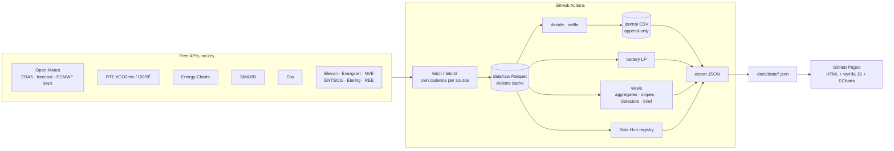

# Intraday Power

**A clean, teaching-first site that shows how the weather drives electricity demand, supply and prices in France and Germany, using free public data only. It also runs two paper-trading bots on Belgian imbalance prices and a battery league. It refreshes every 15 minutes on GitHub Actions.**

**Live site → https://thomaspiton.github.io/Intraday-Power/**


<!-- v1 screenshot; replace with a v2 capture after the first deploy. -->

## What's on it

| Page | What it shows |
|---|---|
| **Today** | Rule-based market brief, day-ahead price curve, key numbers (peak, negatives, load vs forecast, wind+solar share, temperature vs normal) |
| **Weather → Demand** | Temperature vs consumption (heating slope in GW/°C), consumption vs official forecasts, 15-day temperature anomaly with ECMWF ensemble and an indicative GW effect |
| **Weather → Supply** | Observed wind power curve and solar curve, sunny vs cloudy day, 7-day wind/solar outlook with ensemble band next to the TSOs' forecasts, wind & cloud map |
| **Price Drivers** | "A day in the market" (weather → demand & renewables → residual load → price), residual load vs price (merit order), negative-price and Dunkelflaute detectors |
| **Data Hub** | ~50 series in 9 categories (incl. data gaps): value, change, 30-day sparkline, freshness, detail sheet, sources table |
| **Flexibility** | v1 rule and ML bots (Belgium) and Battery League (FR, DE-LU, BE, NL, DK1); the live journal is never reset |
| **Learn** | Glossary (~40 terms), methodology, sources and licences |

Every chart has three folding blocks: *What am I looking at? · Why does a trader care? · How is it computed?* (texts in `docs/content/*.json`). The site **observes, it does not model**: observations, official forecasts and simple statistics only.

## Architecture



| Workflow | When | What |
|---|---|---|
| `update.yml` | every 15 min (:02, :17, :32, :47) | Elia → **decide** → Energy-Charts (hourly gate) → **v2 sources** (éCO2mix 15 min; Open-Meteo, SMARD, Elexon, Energinet hourly; ENTSOG, Elering, REE 6 h; ensemble 12 h; NVE daily; capacities weekly) → settle → battery → export → commit |
| `daily.yml` | 13:30 Europe/Paris | DA prices D+1, day-ahead forecasts, battery LP, weekly ML retrain |
| `backfill.yml` | manual | v1 history, walk-forward backtest, battery on all days |
| `backfill_v2.yml` | manual | v2 history (power since 2023, weather grids 2 years, city temperatures since 2016) + temperature normals; ~2.5 h because of the Open-Meteo quota |
| `test.yml` | on push / PR | `pytest` |

```
src/intraday_power/
  config.py              zones, weather points (cities, wind and solar grids), cadences, v1 strategy parameters
  sources/               energy_charts, elia (v1); open_meteo, eco2mix, smard, elexon, entsog, peripheral (Energinet, NVE, Elering, REE), http
  storage.py             month-partitioned Parquet, idempotent upserts keyed on UTC
  weather.py             country weather indices, temperature normals
  views.py               Today / Demand / Supply / Price Drivers aggregates, detectors, rule-based brief
  datahub_registry.py    one entry per Data Hub row (source, unit, frequency, licence, description)
  pipeline_v2.py         v2 fetch cadences and backfill
  features.py, bots/, battery.py, metrics.py, revisions.py, pipeline.py   v1 (bots, battery)
  export.py, cli.py      python -m intraday_power fetch|fetch2|decide|settle|battery|train|export|backfill|backfill2
docs/                    static site (index.html, assets/, content/*.json, data/*.json)
tests/                   anti-lookahead, journal, storage, battery, metrics, v2 views and registry
```

## Methodology in short

The full version is on the site's *Learn* page and in `DECISIONS.md`.

- **Weather indices**: temperature = 10 cities per country weighted by urban-area population; wind = mean of ~15 points at 100 m on wind areas; solar = mean GHI of ~10 points. Normals = 2016–2025 ERA5 mean per day of year, smoothed ±15 days.
- **Heating slope**: OLS of daily consumption on daily temperature, working days below 15 °C. **Dunkelflaute**: ≥ 2 consecutive days with wind+solar output < 5% of installed capacity.

- **Revision** = (solar + wind)<sub>intraday</sub> − (solar + wind)<sub>day-ahead</sub>, per zone and QH. Alerts fire above each zone's 95th percentile.
- **Bot trade**: `p ∈ {−1, 0, +1}` MW on QH Q, `pnl = p × (imbalance − DA_BE) × 0.25 − 0.5 × |p| × 0.25` EUR.
- **Anti-lookahead.** The decision for Q is taken as of Q − 20 min. It may use:
  - the DA price of Q's day;
  - real-time quarter-hour data up to Q−3 (Elia publishes about 1 min after the QH ends);
  - Elia SI-forecast vintages published before the decision time (ods147 keeps them with timestamps).

  Live decisions are appended to `data/journal/decisions.csv` and are never edited. The code rejects any decision timestamped at or after its QH. A unit test scrambles every value outside the information set and checks that both bots decide the same.
- **Rule bot**: lean against the expected system imbalance (SI < 0 = short = long position). Its threshold was calibrated once on the first 3 months and frozen.
- **ML bot**: LightGBM on sign(imbalance − DA). It is walk-forward: retrained weekly on outcomes published before each cut-off, and trades when P > 0.6.
- **Battery**: 1 MW / 2 MWh, 88% round trip, at most 2 cycles a day, SoC 1 MWh at both ends of the day. Solved as an LP on DA quarter-hours; it is a *theoretical maximum with perfect foresight*.
- **Backtest result (2024-08-26 → 2026-10-17):**

  | Bot | P&L | Hit ratio | Daily Sharpe |
  |---|---|---|---|
  | ML | +618 k€ | 76% | 17 |
  | Rule | +509 k€ | 64% | 14 |

  This mostly reflects how persistent the Belgian imbalance spread is, and Methodology explains why it is not capturable at scale. Judge the bots on the live record.

## Run locally

```bash
python -m venv .venv && source .venv/bin/activate      # Windows: .venv\Scripts\activate
pip install -r requirements.txt && pip install --no-deps -e .
python -m intraday_power backfill        # ~30 min: v1 history (rate-limited) + backtest + battery + export
python -m intraday_power backfill2       # ~2.5 h: v2 history incl. weather (Open-Meteo quota); --no-weather for ~5 min
python -m intraday_power fetch && python -m intraday_power fetch2   # incremental update
python -m intraday_power decide && python -m intraday_power settle && python -m intraday_power export
python -m pytest -q
python -m http.server -d docs 8000       # open http://localhost:8000
```

## Deploy / operate

1. **Settings → Pages**: Source = *Deploy from a branch*, branch `main`, folder `/docs`.
2. **Settings → Actions → General → Workflow permissions**: *Read and write permissions*.
3. **Actions → backfill → Run workflow** once (30–40 min), then **Actions → backfill-v2 → Run workflow** (~2.5 h). They fill the Actions cache and commit the JSON.
4. `update.yml` then runs on its own every 15 minutes. Once the first scheduled run has decided, set `LIVE_START_UTC` in `src/intraday_power/config.py` to that QH, so the UI marks "LIVE since …".

> **Scheduled workflows are disabled after 60 days without repository activity.** If the "last update" badge turns amber and stays that way, open *Actions*, select `update` (and `daily`), and click **Enable workflow**. Any commit to the repo also resets the counter.

If the Actions cache is evicted, nothing is lost. The next run rebuilds 45 days of raw data automatically; run `backfill` to rebuild the full history.

## Data and licences

- **Energy-Charts.info** (Fraunhofer ISE), CC BY 4.0. Day-ahead prices for FR, DE-LU, BE, NL and DK1 are *CC BY 4.0, data from Bundesnetzagentur | SMARD.de* (as stated in the API's `license` field). Attribution: Energy-Charts.info.
- **Elia Open Data** (opendata.elia.be), used under Elia's open-data terms.
- **Open-Meteo** (CC BY 4.0, non-commercial free tier): weather data by Open-Meteo.com; ERA5 by Copernicus/ECMWF.
- **RTE éCO2mix via ODRÉ** (Licence Ouverte v2.0), **SMARD** (CC BY 4.0, Bundesnetzagentur), **Elexon** (BSC data licence), **Energinet** (CC BY 4.0), **NVE** (NLOD), **ENTSOG**, **Elering**, **REE**: see the Data Hub sources table.
- No API keys, no paid data, no synthetic data. A missing series shows as "no data".

## Limitations

- No EPEX continuous intraday prices, TTF or EUA prices (not free): listed under Data Hub → Data gaps.
- One grid-mean wind speed or radiation cannot describe a country: the observed power curves are wide on purpose.
- Paper trading at 1 MW, assumed to be a price-taker; no intraday bid-ask, fees or BRP constraints.
- Hourly price and forecast history is forward-filled to quarter-hours, and flagged as such.
- Denmark's forecasts and actuals are country-wide (DK1+DK2), mapped to the DK1 price zone. NL has no measurable revision because its "intraday" forecast equals the day-ahead one.
- Live coverage depends on GitHub's cron punctuality. A QH without a run in its decision window is simply not traded.
- Elia's new imbalance-price formula (planned for 24 Nov 2026) changes the regime. Results either side of it are not like-for-like.

## Licence

Code: Apache-2.0 (see `LICENSE`). Data: see above.

---
Built by **Thomas Piton** · not investment advice.
