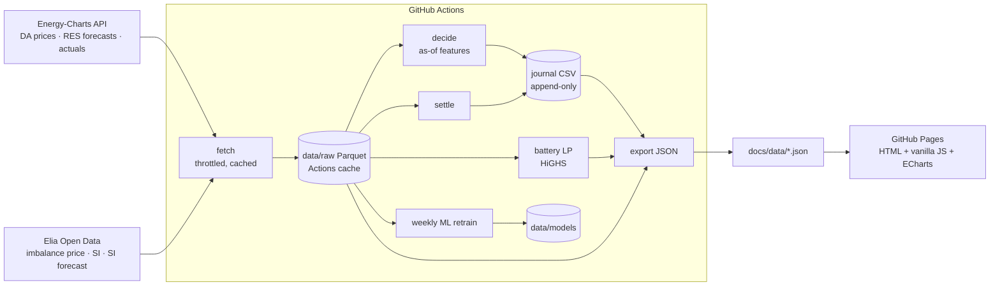

# Intraday Power

**A Bloomberg-style terminal for European short-term power: it measures intraday renewable forecast revisions in five bidding zones, runs two paper-trading bots on Belgian imbalance prices with a strict anti-lookahead protocol, and ranks zones by theoretical battery revenue. It refreshes every 15 minutes on GitHub Actions, using free public data only.**

**Live site → https://thomaspiton.github.io/Intraday-Power/**


<!-- Bots tab, 2026-10-17 (backtest only, before live start). Replace with a GIF once live data accumulates. -->

## Why this matters for an intraday desk

- **Revisions drive intraday prices.** The *Forecast Revisions* tab shows, per zone and quarter-hour, how far the intraday wind + solar forecast has moved from the day-ahead one: the first thing a trader checks after the auction.
- **Robots need monitoring, not just building.** Two bots (rule-based and LightGBM) decide every quarter-hour into an append-only journal, settle against Elia's imbalance price, and report P&L, hit ratio, Sharpe, drawdown and exposure, with backtest and live kept apart.
- **Flexibility has a price.** The *Battery League* solves an LP every day for a 1 MW / 2 MWh battery in FR, DE-LU, BE, NL and DK1, and ranks the zones by the value of their price shape.

## Architecture



| Workflow | When | What |
|---|---|---|
| `update.yml` | every 15 min (:02, :17, :32, :47) | Elia fetch → **decide** → Energy-Charts (hourly gate) → settle → battery → export → commit |
| `daily.yml` | 13:30 Europe/Paris | DA prices D+1, day-ahead forecasts, battery LP, weekly ML retrain (Monday cut-off) |
| `backfill.yml` | manual | full history, walk-forward backtest, battery on all days, alert thresholds |
| `test.yml` | on push / PR | `pytest` |

```
src/intraday_power/
  config.py            zones, Elia dataset ids, strategy parameters (frozen threshold, live start)
  sources/             energy_charts.py (rate-limited client), elia.py (Opendatasoft exports)
  storage.py           month-partitioned Parquet, idempotent upserts keyed on UTC
  features.py          as-of feature construction shared by backtest and live
  bots/                base.py (P&L, append-only journal), rule_bot.py, ml_bot.py (walk-forward)
  battery.py           daily LP per zone
  revisions.py         revision maths and alert thresholds
  metrics.py           P&L statistics
  pipeline.py, cli.py  orchestration: python -m intraday_power fetch|decide|settle|battery|train|export|backfill
docs/                  static site (index.html, assets/, data/*.json)
tests/                 anti-lookahead, journal, storage, battery, metrics
```

## Methodology in short

The full version is on the site's *Methodology* tab.

- **Revision** = (solar + wind)<sub>intraday</sub> − (solar + wind)<sub>day-ahead</sub>, per zone and QH. Alerts fire above each zone's 95th percentile.
- **Bot trade**: `p ∈ {−1, 0, +1}` MW on QH Q, `pnl = p × (imbalance − DA_BE) × 0.25 − 0.5 × |p| × 0.25` EUR.
- **Anti-lookahead.** The decision for Q is taken as of Q − 20 min. It may use:
  - the DA price of Q's day;
  - real-time quarter-hour data up to Q−3 (Elia publishes about 1 min after the QH ends);
  - Elia SI-forecast vintages published before the decision time (ods147 keeps them with timestamps).

  Live decisions are appended to `data/journal/decisions.csv` and are never edited. The code rejects any decision timestamped at or after its QH. A unit test scrambles every value outside the information set and checks that both bots decide the same.
- **Rule bot**: lean against the expected system imbalance (SI < 0 = short = long position). Its threshold was calibrated once on the first 3 months and frozen.
- **ML bot**: LightGBM on sign(imbalance − DA). It is walk-forward: retrained weekly on outcomes published before each cut-off, and trades when P > 0.6.
- **Battery**: 1 MW / 2 MWh, 88% round trip, at most 2 cycles a day, SoC 1 MWh at both ends of the day. Solved as an LP on DA quarter-hours; it is a *theoretical maximum with perfect foresight*.
- **Backtest result (2024-08-26 → 2026-10-17):**

  | Bot | P&L | Hit ratio | Daily Sharpe |
  |---|---|---|---|
  | ML | +618 k€ | 76% | 17 |
  | Rule | +509 k€ | 64% | 14 |

  This mostly reflects how persistent the Belgian imbalance spread is, and Methodology explains why it is not capturable at scale. Judge the bots on the live record.

## Run locally

```bash
python -m venv .venv && source .venv/bin/activate      # Windows: .venv\Scripts\activate
pip install -r requirements.txt && pip install --no-deps -e .
python -m intraday_power backfill        # ~30 min: full history (rate-limited) + backtest + battery + export
python -m intraday_power fetch           # incremental 15-min update
python -m intraday_power decide && python -m intraday_power settle && python -m intraday_power export
python -m pytest -q
python -m http.server -d docs 8000       # open http://localhost:8000
```

## Deploy / operate

1. **Settings → Pages**: Source = *Deploy from a branch*, branch `main`, folder `/docs`.
2. **Settings → Actions → General → Workflow permissions**: *Read and write permissions*.
3. **Actions → backfill → Run workflow** once. It fills the Actions cache, commits the backtest, models and JSON, and takes about 30–40 min.
4. `update.yml` then runs on its own every 15 minutes. Once the first scheduled run has decided, set `LIVE_START_UTC` in `src/intraday_power/config.py` to that QH, so the UI marks "LIVE since …".

> **Scheduled workflows are disabled after 60 days without repository activity.** If the "last update" badge turns amber and stays that way, open *Actions*, select `update` (and `daily`), and click **Enable workflow**. Any commit to the repo also resets the counter.

If the Actions cache is evicted, nothing is lost. The next run rebuilds 45 days of raw data automatically; run `backfill` to rebuild the full history.

## Data and licences

- **Energy-Charts.info** (Fraunhofer ISE), CC BY 4.0. Day-ahead prices for FR, DE-LU, BE, NL and DK1 are *CC BY 4.0, data from Bundesnetzagentur | SMARD.de* (as stated in the API's `license` field). Attribution: Energy-Charts.info.
- **Elia Open Data** (opendata.elia.be), used under Elia's open-data terms.
- No API keys, no paid data, no synthetic data. A missing series shows as "no data".

## Limitations

- No EPEX continuous intraday prices (they are not free). Imbalance prices and forecast revisions serve as proxies.
- Paper trading at 1 MW, assumed to be a price-taker; no intraday bid-ask, fees or BRP constraints.
- Hourly price and forecast history is forward-filled to quarter-hours, and flagged as such.
- Denmark's forecasts and actuals are country-wide (DK1+DK2), mapped to the DK1 price zone. NL has no measurable revision because its "intraday" forecast equals the day-ahead one.
- Live coverage depends on GitHub's cron punctuality. A QH without a run in its decision window is simply not traded.
- Elia's new imbalance-price formula (planned for 24 Nov 2026) changes the regime. Results either side of it are not like-for-like.

## Licence

Code: Apache-2.0 (see `LICENSE`). Data: see above.

---
Built by **Thomas Piton** · not investment advice.
